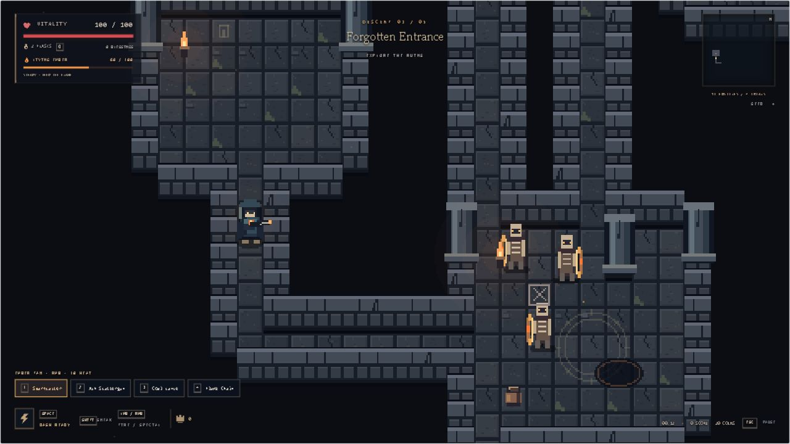

# Below the Ember

An AI educational dungeon crawler by **Bekzat Zhailkhan**, the sole student participant in this AI Fundamentals final project. Version 2.3.2 uses TypeScript, Phaser 3 and Vite. It runs locally in a browser without a backend, AI API key or paid service.

Public repository: [deboutalltime/below-the-ember](https://github.com/deboutalltime/below-the-ember). The repository and source download were verified without authentication on 25 October 2026.

The player carries the last ember through five seeded floors. The game combines four weapons, 18 upgrades, heat, room objectives, a shelter and a two-phase final boss. The interactive AI Laboratory explains the same core algorithms used by the campaign.



## Quick start

Use Node.js 22 or Node.js 20.19 or later. Install pnpm 10, then run:

```sh
pnpm install --frozen-lockfile
pnpm dev
```

Open http://127.0.0.1:5180/. `Start-Game.ps1` also starts the game on Windows. Open the page through an HTTP server, not directly from disk. npm is also supported with `npm install` and `npm run dev -- --port 5180`; the committed pnpm lockfile is the reproducible installation path.

```sh
pnpm test
pnpm build
pnpm metrics
pnpm verify:campaign
pnpm preview
```

`dist/` is the production application. Serve it using Vite preview or a static HTTP host. Development-only visual fixtures are excluded from production. There is no telemetry, account system or runtime AI API request.

## Three distinct AI Fundamentals weeks

| Course week | Implemented method | Where to inspect |
|---|---|---|
| 1 Agents and environments | Perception, memory and a finite state machine | Enemy AI and Agents Laboratory |
| 2 Search and heuristics | A* with a min-heap and Manhattan distance | Enemy routes and A* Laboratory |
| 3 Constraint satisfaction | Seeded room assignment with bounded backtracking | Dungeon generation and CSP Laboratory |

BFS, Dijkstra and A* belong to the same course week. Additional experiments include Minimax with alpha-beta pruning, Q-learning, a Bayesian belief filter, utility decisions, GOAP, a behavior tree and genetic encounter selection. Q-learning is a separate educational arena and does not train campaign enemies. The Bayesian module is a filter, not a complete Bayesian network.

## Controls

| Action | Input |
|---|---|
| Move and aim | WASD or arrow keys and mouse |
| Main and special attack | Left and right mouse buttons |
| Select weapon | 1-4 or HUD buttons |
| Charge Coal Lance | Hold and release the left mouse button |
| Dash and sneak | Space and Shift |
| Heal and interact | Q and E |
| Pause and AI observations | Escape and F3 |
| Choose an upgrade | 1-3 or mouse |

Clear enemies and required room objectives to unlock the stairs. Defense requires its timer and reinforcements. Leave a cleared collapse room to finish its task. The no-flask oath is optional. Floors 1-4 lead to a shelter; the fifth contains the Ember Warden. Continue restores statistics at the entrance of the current floor and resets that floor's encounters. It is not an exact mid-battle save.

The English prologue opens before a new run and can be skipped with its button or Escape. Russian remains an optional story translation. Settings controls sound, music, effects, camera shake and full animation. Browser audio starts after a user gesture.

## Architecture

| Module | Responsibility |
|---|---|
| src/simulation.ts | Combat, resources, objects, objectives and campaign transitions |
| src/dungeon.ts | CSP, seed handling, corridors, connectivity and generation metadata |
| src/ai.ts | A*, sight and the enemy FSM |
| src/game/ | Weapons, upgrades, input guards and environment |
| src/intelligence/ | Additional algorithms, enemy mind and advanced laboratory |
| src/visuals/ | Procedural art, animation and disposable Phaser views |
| src/audio/ | Synthesized score and adaptive music scheduling |
| src/story/ | Animated story, its timeline and optional translations |
| src/lab.ts and src/ui/ | Interactive algorithms, menus and DOM HUD |

## Evidence and submission materials

- [Technical report source](docs/Technical_Report.md) and [PDF](output/pdf/Below-the-Ember-Technical-Report.pdf)
- [AI usage declaration](docs/AI_Usage_Declaration.md) and [PDF](output/pdf/Below-the-Ember-AI-Usage-Declaration.pdf)
- [Individual contribution statement](docs/Team_Contribution_Statement.md) and [PDF](output/pdf/Below-the-Ember-Contribution-Statement.pdf)
- [Seven-slide presentation](submission/Below-the-Ember-Final-Presentation.pptx)
- [Demo video](submission/Below-the-Ember-Demo.mp4), [English captions](submission/Demo-Captions.srt) and [recording details](submission/Demo-Manifest.json)
- [Defense guide](docs/Defense_Guide.md), [submission checklist](SUBMISSION_CHECKLIST.md) and [references](docs/References.md)
- [Latest tests](docs/results/tests.txt), [algorithm metrics](docs/results/metrics.json) and [campaign experiment](docs/results/campaign.json)

The full test run passes 50 tests and includes 100 basic and 50 expanded seeded map configurations. A separate automated driver completed five floors with normal actions, 98 defeated enemies and 20 completed mandatory objectives for seed `qairu-final-2026`. It uses complete state information for testing and is not a human browser playthrough. `pnpm verify:campaign` reproduces that experiment without removing enemies, overriding objectives, teleporting or boosting player statistics.

## Limits

Full human completion and long-term balance remain unverified. Mobile controls, gamepads, multiplayer and exact battle saves are not implemented. CSP uses a bounded randomized search and a regular fallback layout; the laboratory labels fallback and trace truncation explicitly. Generation accepts whole numbers only and reports invalid inputs. The large Phaser bundle produces a size warning, not a build failure. See [verification](VERIFICATION.md) for scope and results.

The student must understand and explain the algorithms during the defense. AI contributed substantially to implementation, tests and documentation; the declaration records this assistance. Declaration signatures, if requested by the instructor, must be completed by the student.
