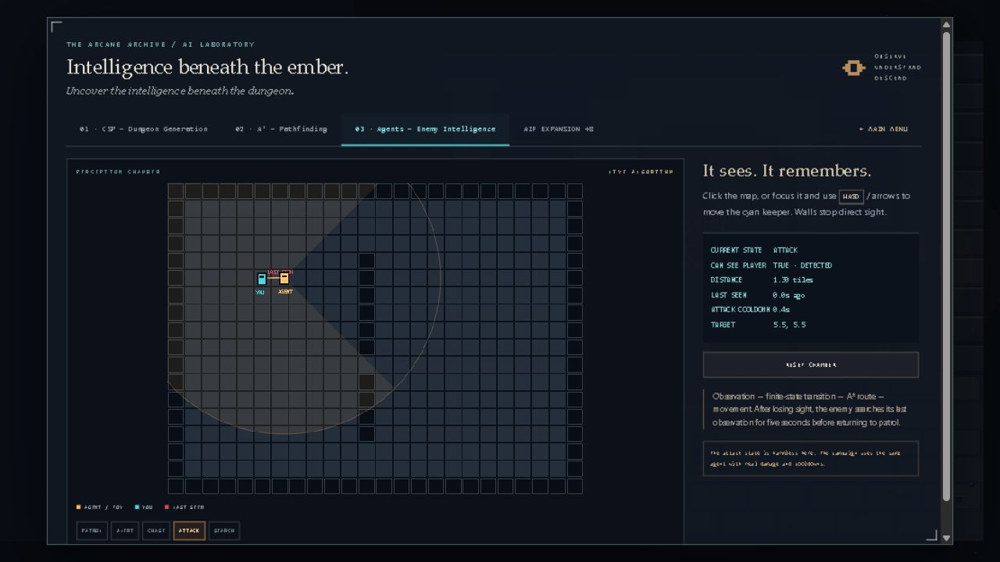
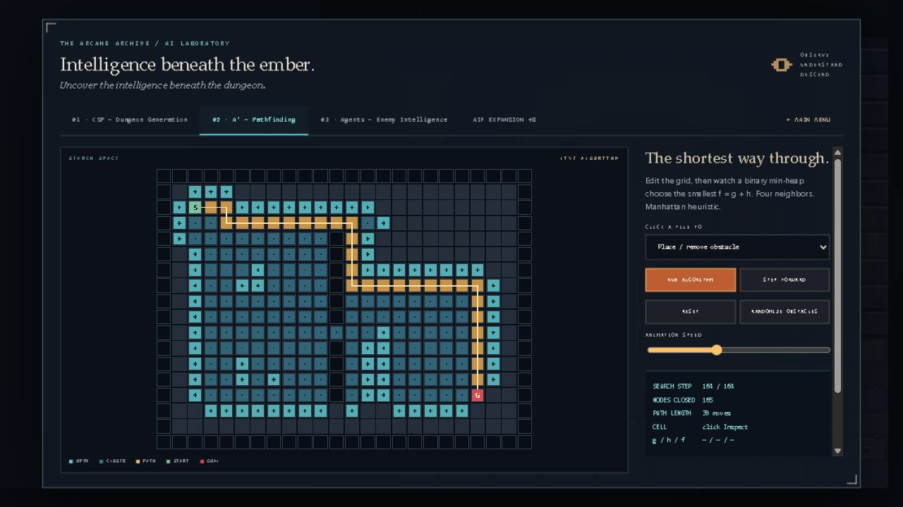

# Below the Ember Technical Report

**AI Fundamentals Final Project 2026**

Student: Bekzat Zhailkhan

Individual project, version 2.3.2, 25 October 2026

## Purpose and result

Below the Ember is a working browser game and an interactive AI learning tool. The player carries the last ember through five dungeon floors, fights enemies and faces the Ember Warden. The laboratory makes the algorithms visible through editable inputs, steps and measured results.

The project implements three main AI topics from three different course weeks. The methods execute locally in TypeScript. The application does not depend on a hosted AI API. A separate declaration explains substantial AI assistance during development.

| Course week | Method | Product role |
|---|---|---|
| 1 | Intelligent agents | Enemies observe, remember and change behavior. |
| 2 | A* search | Agents find routes around walls and hazards. |
| 3 | CSP | A bounded solver places rooms under geometric constraints. |


The image shows the normal browser application. The submission includes 50 passing tests, reproducible algorithm metrics and an automated five-floor campaign experiment. Full human completion and broad balance testing remain unverified.

<!-- PAGE -->

## Product and architecture

The game offers four weapons and 18 upgrades. Heat increases damage and enemy visibility at high values; special attacks spend heat. Required encounters include combat, defending a ward, leaving a collapse room and a trial with an optional no-flask oath. Shelters provide forging, flasks, trades and contracts. The fifth floor contains a two-phase boss with visible warnings.

The simulation owns the game rules. Phaser adapts input and draws disposable views of that state. DOM elements provide menus and the HUD. This separation lets tests run the rules without WebGL or a browser.

| Module | Responsibility |
|---|---|
| src/simulation.ts | Combat, statistics, objectives, transitions and checkpoint data |
| src/dungeon.ts | Seeded CSP, corridors, reachability and solver metadata |
| src/ai.ts | A*, line of sight and the finite state machine |
| src/game/ | Weapons, upgrades, environment and input guards |
| src/intelligence/ | Tactical decisions, additional methods and advanced lab |
| src/visuals/ | Procedural pixel art, actor motion and Phaser rendering |
| src/audio/ and src/story/ | Original synthesis, adaptive music and prologue timeline |

TypeScript provides type checking. Phaser 3 provides the 2D runtime [6]. Vite 6 runs the development server and builds static files [7]. Web Audio synthesizes effects and eight adaptive arrangements [9]. No backend, secret key or external dataset is needed.

### Inputs and persistence

WASD or arrows move the player, mouse buttons attack, 1-4 select a weapon, Space dashes, Q heals, E interacts and Escape pauses. Laboratory controls edit seeds, map settings, obstacles, agent conditions and learning parameters. Generation rejects non-integer or out-of-range settings with a clear message and preserves the previous map.

Continue restores player statistics at the entrance of the current floor. Enemies and encounter progress restart. It is a checkpoint, not an exact mid-battle save. Audio requires a browser user gesture. Reduced animation preserves essential warnings while removing moving effects.

<!-- PAGE -->

## Week 1 Intelligent agents

**Goal:** choose an enemy action from observations of the environment. An agent connects sensing with action [1].

**Input:** walkable grid, agent and player positions, facing angle, view range, field of view, elapsed time and cooldowns. Campaign extensions also receive noises, nearby allies and the ward.

**Output:** state, last known target position and route. The five FSM states are PATROL, ALERT, CHASE, ATTACK and SEARCH. FSM means finite state machine.

### Processing stages

1. Check distance and view angle, then test whether walls block the line of sight.
2. Update the last visible player position and time since detection.
3. Enter ALERT after detection and allow a short reaction delay.
4. Chase the target, attack within range, or search after losing sight.
5. Return to patrol after the search timeout. A* supplies movement routes.

In the campaign, utility scores choose tactical intentions and GOAP supplies a short action plan. These decisions remain constrained by perception and cooldowns. This is an explicit rule-based system, not a trained neural network. Limited sight makes the game environment partially observable to enemies.

### Test and observed result

The core test observes ALERT, CHASE and ATTACK, inserts a wall, then verifies SEARCH and PATROL. A separate test confirms that a shot can trigger investigation without sight. The browser laboratory also reaches ATTACK with TRUE DETECTED after moving the player into view.



**Code:** src/ai.ts, src/intelligence/EnemyMind.ts and src/simulation.ts. **Tests:** tests/core.test.ts and tests/adventure.test.ts. Laboratory attacks are harmless; campaign attacks apply real damage. View rules and tactical scores are hand-designed, so this result does not demonstrate learned intelligence.

<!-- PAGE -->

## Week 2 A-star search

**Goal:** find a route through walkable cells. **Input:** a grid, start, goal and optional cell-entry costs. **Output:** path, visited nodes, g/h/f scores and an optional search trace.

A* prioritizes f(n) = g(n) + h(n). The g value is cost already paid. The h value estimates remaining cost [2]. The project uses Manhattan distance: |x - goalX| + |y - goalY|. Four-direction movement and entry costs of at least one make this a lower bound.

### Processing stages

1. Put the start in a min-heap with its estimated priority.
2. Remove the lowest-priority node and skip an already closed entry.
3. Check its four neighbors. Update a cheaper g and store the parent.
4. Stop at the goal and reconstruct the route through parent links.
5. Return an empty route when the goal cannot be reached.

The standard laboratory map gives **30 moves and 165 closed nodes**. Tests check shortest detours, cardinal adjacency, walls and unreachable goals. A weighted example compares the same start and goal with expensive hazard cells:

| Method | Moves | Total cost | Visited nodes |
|---|---|---|---|
| BFS | 11 | 65 | 93 |
| Dijkstra | 13 | 13 | 105 |
| A* | 13 | 13 | 28 |



**Code:** src/ai.ts and src/intelligence/search.ts. **Tests:** tests/core.test.ts and tests/intelligence.test.ts. These figures describe one map, not a universal speed ranking. The trace copies intermediate sets and costs extra memory. Routes are static within a call; moving campaign targets trigger periodic recalculation. BFS, Dijkstra and A* count as one course week.

<!-- PAGE -->

## Week 3 Constraint satisfaction

**Goal:** place rooms without overlap and with minimum separation. **Input:** seed, map size, room count and separation. **Output:** rooms, corridors, initial contents and search metadata. A CSP describes variables, domains and constraints [3].

Room variables contain x, y, width and height. Seeded random candidates form a sampled domain. Bounds keep rooms inside the grid. Pairwise checks enforce non-overlap and separation. Recursive search accepts a valid room, continues, and undoes the choice if a deeper branch fails.

```text
solve(roomIndex):
  if all rooms are assigned: return success
  while candidates and budget remain:
    propose a seeded candidate
    if constraints hold:
      assign the room
      if solve(next room) succeeds: return success
      undo the assignment
  return failure
```

After placement, corridors form a spanning chain. A reachability check confirms that room centers and the exit are connected. Corridor carving is a separate stage, not a global CSP over every dungeon tile.

| Experiment | Standard | Dense request |
|---|---|---|
| Seed | ember-2026 | dense-trace |
| Size / rooms / separation | 64 / 8 / 2 | 48 / 12 / 4 |
| Candidate attempts | 11 | 6000 |
| Recorded trace events | 11 | 1500, truncated |
| CSP succeeded | Yes | No |
| Fallback used | No | Yes |
| Final map connected | Yes | Yes |

**Limits:** search stops after 6000 candidates, with at most 1500 trace entries. Failure produces a regular fallback map. The UI now labels fallback and truncation and separates shown backtracks from the total. The dense case has 23 shown backtracks and 107 total.

**Tests:** valid partial assignments and real rollback events; deterministic output; 100 basic and 50 expanded map configurations; parameter boundaries; rejection of 6.5, 0, 100, NaN and Infinity. **Code:** src/dungeon.ts and src/lab.ts. **Tests:** tests/core.test.ts, tests/trace.test.ts, tests/generation.test.ts and tests/adventure.test.ts.

<!-- PAGE -->

## Additional AI experiments

### Week 4 Minimax and alpha-beta pruning

The rune duel is a deterministic 3x3 game. Minimax evaluates terminal wins, losses and draws, then alternates maximizing and minimizing turns. Alpha-beta pruning skips branches that cannot change the decision [4]. The laboratory lets users switch pruning on or off and inspect node counts.

| Empty-board analysis | Nodes | Best move | Value |
|---|---|---|---|
| With pruning | 34,202 | 1 | 0 |
| Without pruning | 549,945 | 1 | 0 |

The test also checks an immediate win and a blocking move. This is a small perfect-information game, not a general adversarial strategy system. Code: src/intelligence/minimax.ts.

### Week 5 Q-learning

A small agent starts with an empty Q-table and uses epsilon-greedy exploration. Its update is Q(s,a) = Q(s,a) + alpha [reward + gamma max Q(nextState,a) - Q(s,a)] [5]. Terminal rewards omit the future-value term. Users edit the episode count, learning rate and discount factor.

With seed ember-learning, the initial greedy policy loops. After 1000 episodes with alpha 0.2 and gamma 0.95, it reaches the goal. Recent success is 98% in the last 50 training episodes. The test checks a reproducible non-zero table and a route that avoids walls and traps. This is training performance on one fixed arena, not an unseen-map evaluation. Campaign enemies do not use Q-learning. Code: src/intelligence/learning.ts.

### Probability and other methods

A discrete Bayesian filter predicts movement, applies sight or sound likelihoods, and normalizes belief over possible player cells. Tests check probability mass, wall cells and evidence updates. It is a filter, not a full Bayesian network with a graph and conditional probability tables.

Utility AI, GOAP, the boss behavior tree, genetic encounters and search comparisons are interactive extensions. They do not automatically count as additional course weeks. The primary submission claim remains the three well-defined weeks of agents, A* and CSP. All ten course topics are not required by the Final Project guideline.

<!-- PAGE -->

## Testing and verification

The latest full suite passes **50 tests with zero failures and zero skips**. TypeScript checking and the production build pass. The final JS bundle is 1,668.61 kB, about 410.07 kB gzip. Vite reports a size warning because Phaser is large.

The suite covers deterministic geometry, 150 map configurations, routes, perception, combat, damage immunity, upgrades, room objectives, checkpoint statistics, audio synthesis and scheduling, animation and the prologue timeline. Browser checks complement tests because a CSS input bug can pass simulation tests.

| Audit defect | Correction | Verification |
|---|---|---|
| Mouse blocked in prologue | Root enables pointer events | Next, scene selection, return and Skip work with mouse |
| Fractional room count | Shared generator validation and clear errors | Negative tests pass; 6.5 leaves the old map unchanged |
| Hidden fallback | Explicit solver and trace metadata | Dense case displays fallback, truncation and total counts |

### Complete campaign experiment

The normal-action automated driver reaches victory with seed qairu-final-2026. It completes five floors, defeats 98 enemies and finishes all 20 mandatory objectives in 391.8 simulated seconds. It uses normal movement, attacks, healing, upgrade choices and camp actions. It never removes enemies, overrides objectives, teleports or boosts statistics.

The driver can inspect the entire simulation state and does not run the browser renderer. This is one reproducible integration experiment. It is not a human playthrough or a balance study. An earlier transition unit test clears conditions artificially; the separate campaign driver avoids that shortcut.

### Browser evidence and limits

The checked browser session has no captured warning/error entries. Actual frames in the 2-minute-30-second video show normal gameplay and defeat, editable CSP, search animation, agent perception and Q-learning. Captures run at about 5 fps and encode at 25 fps; the separately mixed music comes from the game's synthesis code.

Human full completion, other browser engines, mobile/gamepad play, long-term balance and physical-speaker output remain unverified. No multiplayer, exact battle save or learned campaign policy is claimed. Future work includes memory choices, mini-bosses, richer environmental interactions and broader accessibility.

<!-- PAGE -->

## Reproduction and references

Use Node.js 22 or 20.19+, with the committed pnpm lockfile. Install pnpm 10 or later. From the project folder:

```sh
pnpm install --frozen-lockfile
pnpm test
pnpm build
pnpm metrics
pnpm verify:campaign
pnpm dev
```

Open http://127.0.0.1:5180/. The code also ran with bundled Node 24.22.1 and pnpm 11.25.0 during preparation. Logs and machine-readable outputs are under docs/results. Read the README for controls and floor checkpoint behavior. The repository contains no secret API key requirement.

The separate AI Usage Declaration and Individual Contribution Statement explain the student's role and AI assistance. The seven-slide presentation includes speaker notes. The Defense Guide supplies the live-demo order and practice questions. Student review and independent explanation remain necessary.

### Primary sources

[1] UC Berkeley CS 188, Agents. https://inst.eecs.berkeley.edu/~cs188/textbook/search/agents.html

[2] UC Berkeley CS 188, Informed Search. https://inst.eecs.berkeley.edu/~cs188/textbook/search/informed.html

[3] UC Berkeley CS 188, Constraint Satisfaction Problems and Solving CSPs. https://inst.eecs.berkeley.edu/~cs188/textbook/csp/csps.html and https://inst.eecs.berkeley.edu/~cs188/textbook/csp/solving.html

[4] UC Berkeley CS 188, Minimax. https://inst.eecs.berkeley.edu/~cs188/textbook/games/minimax.html

[5] UC Berkeley CS 188, Model-Free Learning. https://inst.eecs.berkeley.edu/~cs188/textbook/rl/mfl.html

[6] Phaser Studio, What is Phaser. https://docs.phaser.io/phaser/getting-started/what-is-phaser

[7] Vite, Vite 6 Getting Started. https://v6.vite.dev/guide/

[8] Microsoft, The TypeScript Handbook. https://www.typescriptlang.org/docs/handbook/intro.html

[9] MDN Web Docs, Web Audio API. https://developer.mozilla.org/en-US/docs/Web/API/Web_Audio_API

[10] QAIRU AI Fundamentals Final Project 2026 guideline supplied by the student, sections 1-14. Sources accessed 25 October 2026. Procedural graphics and audio originate in project code; library notices remain with their packages.
